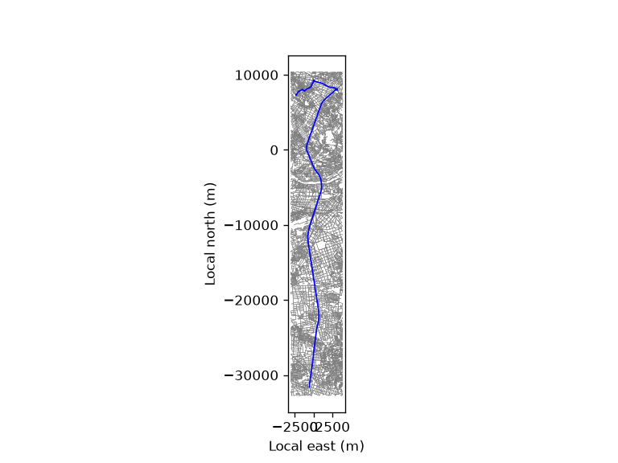
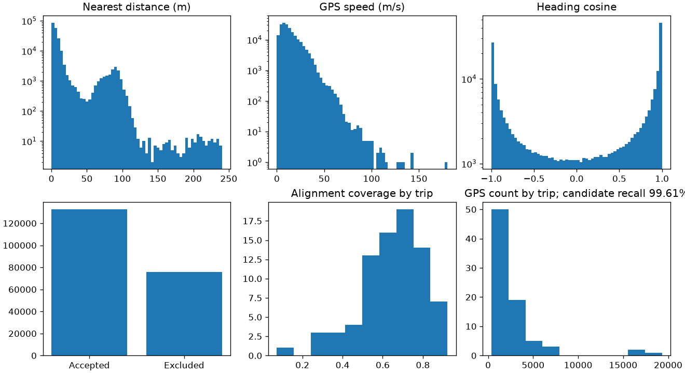

# GPS Preprocessing, Dataset Validation, and Candidate Generation

**Student contribution:** Chetha Samrutha (PES1UG24CS131), Data and Geospatial Lead
**Scope:** GPS input handling, local geometry, road candidates, and reference-proxy data checks.

## Dataset structure and parsing

The PathSnap dataset is organized by trip. A trip contains four headerless, whitespace-separated files. The `.track` table stores longitude, latitude, and timestamp in seconds for each GPS observation. The `.nodes` table stores longitude and latitude; a node's zero-based row number is its node ID. The `.arcs` table stores directed `from_node_id` and `to_node_id` pairs; its row number is the original directed arc ID. The `.route` file is a chronological sequence of reference arc IDs traversed by the vehicle [1]. The code parses track and node coordinates as floating point values and arc and route IDs as integers.

The training-only audit read 80 trips and 208,417 GPS observations. It checked expected table dimensions, finite and geographically bounded coordinates, and in-range arc endpoints and route IDs. No malformed training trip, duplicate full GPS row, or nonpositive timestamp interval was found. Timestamps are specified in seconds, but their epoch and timezone are undocumented. The pipeline uses differences between successive timestamps as elapsed time, rather than interpreting them as calendar time.

## GPS projection and road geometry

Candidate generation reads positions as `[longitude, latitude]`. For each trip, it uses the component-wise median GPS coordinate as a local origin. It converts longitude and latitude differences to metres using 111,195 metres per degree, applying a cosine-of-origin-latitude factor to the east-west scale. This local equirectangular approximation makes trip-scale geometry practical; it is not a global geodesic projection, and its scale error can grow over wider areas or at higher latitudes.

For a projected GPS point (p) and segment endpoints (a) and (b), the implementation computes the projection fraction

\[
t = \mathrm{clip}\left(\frac{(p-a)\cdot(b-a)}{\max(\lVert b-a\rVert^2, 10^{-12})}, 0, 1\right),
\]

then uses (a+t(b-a)) as the closest point on the finite segment. The perpendicular distance is the Euclidean distance from (p) to that point; segment length is the Euclidean distance between (a) and (b). Both are in metres in the local plane. The small denominator floor prevents division by zero. For a zero-length segment, the closest point is its endpoint, so distance remains defined and segment length is zero. The audit found and retained 100 zero-length arc geometries.

## Eight-candidate road search

The reference route is not an input to candidate generation. Each directed road arc is sampled along its geometry at intervals of approximately 20 metres or less. A `cKDTree` retrieves up to 64 nearby sample points for a GPS observation. The implementation combines the owning arcs with up to eight arcs selected near the observation by midpoint distance, removes duplicate arc IDs, computes exact point-to-segment distances for that shortlist, and keeps the closest eight candidates. Candidate IDs continue to refer to their original rows in `.arcs`.

Within the shortlisted pool, arc IDs are sorted before a stable distance sort, so equal final distances retain ascending arc-ID order. Because the spatial index limits which arcs receive exact distance calculations, the method does not guarantee that the globally nearest segment is always shortlisted. A reproducible check sampled six evenly spaced observations per training trip and compared each shortlist against an exhaustive distance scan over all trip arcs. All 480 sampled shortlists retained an exact nearest segment (ties within (10^{-8}) m counted as equal). This is evidence on those sampled points, not an exhaustive guarantee.

## Ordered reference-proxy alignment

The `.route` sequence is used in reference-label construction and evaluation, not to produce candidates or to make inference predictions. The alignment function computes GPS-to-segment distances against route occurrences in sequence order. Its dynamic program allows observations to stay on a route occurrence or advance to a later occurrence, including skipping intervening route steps. Repeated appearances of an arc remain separate positions in the ordered route sequence during alignment, while the classification target remains the original `arc_id`.

The path-distance cost is clipped at 100 m. A GPS observation receives a proxy arc label only when its selected route segment is within 35 m and the best complete-path alternative with a different arc ID costs at least 8 m more. Otherwise, the label is rejected as uncertain and represented by `-1`. Accepted labels whose arc is absent from the eight candidates are counted as candidate misses and as failures in observation-level Top-1 evaluation.

These labels are **reference-route proxies**, not independently verified physical ground truth. The dataset description calls `.route` a chronological ground-truth arc sequence but warns that supplied routes may not be independently verified or error-free. GPS noise, close parallel roads, and route errors can therefore still produce incorrect accepted proxies [1].

## Shared candidate features

Training and inference use the same five features in the same order:

| Feature | Meaning |
|---|---|
| `distance_m` | Distance from the GPS point to the candidate road segment, in metres. |
| `heading_cos` | Cosine between the directed segment vector and incoming GPS displacement; this represents circular direction without a discontinuity at north. |
| `fraction` | Clamped position of the closest point along the segment, from 0 to 1. |
| `length_m` | Candidate segment length, in metres. |
| `speed_mps` | Incoming GPS displacement divided by the actual time elapsed, in metres per second. |

Heading is missing when displacement is under 2 m or elapsed time is nonpositive. Speed is missing on the first observation and when elapsed time is nonpositive. Inference converts `None` and nonfinite feature values to NaN; the fitted model pipeline applies median imputation and missingness indicators. Identifiers and route IDs are not included as predictors.

## Training-data verification

The verified archive contained 80 training trips and 208,417 GPS observations. The shared alignment accepted 132,596 reference-proxy labels, giving a coverage of (132{,}596 / 208{,}417 = 63.6205%\). There were 520 candidate misses among accepted labels, so candidate recall was ((132{,}596 - 520) / 132{,}596 = 99.6078%\). Candidate recall describes whether the reference-proxy arc appeared in the generated candidates; it is not classifier accuracy.

Of 208,337 adjacent timestamp intervals, 201,053 (96.50%) were one second within the audit tolerance. No interval was nonpositive; the largest gap was 153,064 seconds. These gaps reinforce the use of actual elapsed seconds. The audit also observed 100 zero-length road arcs. They were retained, with their geometry handled by the denominator floor described above.

The training-only scan, per-trip results, archive fingerprint, denominators, and figure hashes are recorded in `results/final/evidence/chetha-preprocessing-verification/`. Student-test and evaluator data were not used to tune these preprocessing decisions or compute the statistics in this section.

## Figures and tests

**Figure 1.** Local-plane overlay of GPS observations and the road network for a training trip. Axes are local east and north in metres.

**Figure 2.** Training-only feature distributions and proxy-label audit summaries. The accepted/excluded bars represent reference-proxy coverage; the stated candidate recall is a candidate-set measure.

The original preprocessing audit run completed with 44 tests passed and one Starlette deprecation warning. After route stitching was merged, the full suite was run again: 47 tests passed in 18.62 seconds. The recorded log is `results/final/evidence/stitching-tests.log`. The shared pipeline tests cover repeated route arcs, skipped route steps and ambiguity rejection; reference-free candidate generation and deterministic candidate IDs; missing heading values; trip-grouped splitting; feature schema/order validation; and serialized inference behavior. The data audit also independently checks actual training-file dimensions and IDs.

## Limitations

- Reference-route labels are proxies and can contain errors; they are not independent physical ground truth.
- Timestamp epoch and timezone are unspecified. Only elapsed differences are used.
- The local projection is an approximation.
- The spatial index creates a bounded candidate shortlist. The 480-point exact-nearest comparison is sampled evidence only.
- The 100 zero-length arcs were retained; their source-network meaning is not established by this audit.
- The inference `TripStore` does not explicitly require strictly increasing timestamps. The audited training data had no nonpositive interval, and this API-owned behavior was not changed as part of my preprocessing contribution.

## References

[1] PES University, *PathSnap: Dataset Description and Exploration*, supporting document, sections 3, 5-7. The document defines the raw table columns and partition rules and cautions against treating supplied routes as independently verified, error-free physical truth.

**Implementation and evidence reviewed:** `pathsnap_ml/data.py`, `pathsnap_ml/inference.py`, `pathsnap_ml/test_pipeline.py`, `docs/CHETHA_PREPROCESSING_VERIFICATION.md`, `docs/TEAM_VERIFICATION.md`, and the Chetha preprocessing verification evidence folder.
